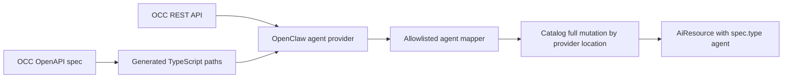

# Design: OpenClaw Enterprise Agent Catalog Provider

## Canonical Touchpoints

None under `specifications/prd/`, `specifications/adr/`, or
`openspec/specs/`. The proposal's related references are change-local working
documents, not long-lived canonical specifications.

**No canonical document updates.**

## Context

[RHDHPLAN-1885](https://redhat.atlassian.net/browse/RHDHPLAN-1885) evaluates
OpenClaw Enterprise and identifies catalog surfacing as a possible RHDH
integration. The issue describes an evaluation spike and lists production
implementation as out of scope. This change captures a separate,
demo-oriented prototype, not an adoption decision.

The integration notes in the OpenClaw Enterprise checkout describe OCC's REST
API, its OpenAPI 3.1 document at
`packages/contracts/openapi/occ-api.openapi.json`, and the lack of a published
npm client. The current source document is from OpenClaw Enterprise revision
`92cc1a89c`. `GET /namespaces` resolves current namespace IDs and
`GET /namespaces/{namespaceId}/agents` returns agent records. Agent list records
also include configuration and credential-related fields, so the provider must
project an allowlist instead of copying API objects into catalog entities.

The `ai-resource-catalog-entity-kind` change owns the base `AiResource` kind,
and `airesource-agent-typed-schema` owns the singular `spec.type: agent`
contract. This provider depends on the base kind being defined and registered,
as well as the `catalog-model-ai-resource-agent` package and
`catalog-backend-module-ai-resource-agent` validation module. Before
implementation, verify all prerequisites are present and registered on the
target branch; apply the owning change first wherever its contribution is
missing. This provider consumes those contracts and does not redefine them.
The model-catalog and skills-catalog providers show the workspace's Backstage
`EntityProvider`, scheduler, and source-scoped mutation patterns.

## Goals / Non-Goals

**Goals:**

- Discover one configured OCC namespace and import its agents on a Backstage
  schedule.
- Emit stable, source-scoped `AiResource` agent identities and expose useful
  OpenClaw status metadata without importing agent configuration or secrets.
- Preserve catalog state through OCC outages and malformed or incomplete
  responses; remove entities only after a complete successful snapshot.
- Make an active agent's browser-chat link available when the operator
  configures the deployment's native-admin domain.

**Non-Goals:**

- Agent creation, provisioning, invocation, editing, or runtime status UI.
- Importing configuration, instructions, model settings, credential references,
  repository access, or service-principal data.
- Changing `AiResource` typing, adding a frontend, or making OCC calls from a
  browser.
- Deploying OpenClaw Enterprise or packaging this prototype for product support.

## Decisions

### D1 — Use one backend provider for this single OCC source

**Choice:** Add a catalog backend module that calls OCC and constructs
`AiResource` entities directly. Keep acquisition, mapping, and catalog
reconciliation in the module, with a small typed API client boundary.

**Alternatives:** A separate OCC connector plus a common entity provider would
mirror the OCI and skills architecture more closely, but this prototype has one
upstream and one consumer. That split would add a second plugin, an internal
REST contract, and service-to-service authentication without a current second
consumer. Revisit the split if another RHDH feature needs normalized OCC agent
records.

### D2 — Generate a typed client from OCC's OpenAPI source

**Choice:** Vendor the OCC OpenAPI document as
`plugins/catalog-backend-module-openclaw-agent-provider/openapi/occ-api.openapi.json`
from OpenClaw Enterprise revision
`92cc1a89c069f865ad53d769f22f14abb1292b53`. Its SHA-256 is
`2ac1310c77464af9741f91d17e06dcfe2768c8f1edd242118c2c8d2d38a06e06`; the
regeneration script SHALL verify this digest before generating TypeScript path
types into the provider package with `openapi-typescript`. Use those types with
`openapi-fetch`. Check in the generated declarations and the regeneration
script. Do not depend on an unpublished OCC npm package, fetch a mutable source
branch, or run code generation during RHDH startup.

The generated declarations provide compile-time types, not runtime validation.
The client boundary will validate the response envelope and the pinned
OpenAPI-required fields used by namespace selection and agent projection,
including the two agent-list variants (readable configuration and
`configurationReadError`). Optional fields such as `activeRevisionId` may be
absent and are omitted from the entity when absent. Unknown properties are
ignored and never projected, including future or sensitive OCC configuration
properties.

**Alternatives:** Hand-maintained request and response types were rejected
because they would drift from OCC's source contract. Importing a private OCC
workspace package is not available because OCC publishes no reusable npm
client. Runtime OpenAPI code generation was rejected because generated types
can be checked in and do not need to run during RHDH startup.

### D3 — Keep OCC credentials and TLS handling in the backend

**Choice:** Configure the OCC API base URL and service key under backend-only
provider config. Send the key only as the `x-api-key` request header. Use a
least-privilege service key for namespace and agent reads. Require an HTTPS
base URL, disable automatic redirect following, reject all 3xx responses before
issuing another request, and use a finite request timeout.
Mark the OCC URL and service-key properties `@visibility backend` in
`config.d.ts`.
For deployments using OCC's private CA, document trust through Node's
`NODE_EXTRA_CA_CERTS`; do not disable certificate verification.

The optional native-admin domain is validated as a hostname, not accepted as a
URL. The HTTP client disables automatic redirect following and rejects every
3xx response before issuing another request; a redirect target therefore
cannot receive the service key. No secret, request header, or raw response
object is included in a log or catalog entity.

**Alternatives:** Browser-side calls were rejected because they would expose
the OCC key. Disabling TLS certificate verification was rejected because it
would remove endpoint authentication. Following redirects and checking the
final URL afterward was rejected because the key could already have been sent
to the redirect target.

### D4 — Resolve ephemeral namespace IDs on every refresh

**Choice:** Each configured provider instance targets one namespace by name,
defaulting to `default`. On each refresh, call `GET /namespaces`, require
exactly one namespace with that exact name across all statuses, and require
that namespace to have `status: ready` before calling
`GET /namespaces/{namespaceId}/agents`. Do not persist namespace IDs between
runs. When chat links are enabled, read only the installation ID from
`GET /installation`; failure of that optional lookup omits links but does not
block importing agents.

Do not call the agent detail, configuration, native-admin status, or chat
endpoints. If multiple namespaces are needed, configure independent provider
instances.

**Alternatives:** Persisting a namespace ID in configuration was rejected
because OCP installations are ephemeral and IDs change. Selecting the first
namespace returned was rejected because list order does not identify the
configured tenant. Resolving the configured name on each refresh is explicit
and follows the current OCC response.

### D5 — Map a small allowlist and keep runtime state out of lifecycle

**Choice:** Map the OCC agent name to `metadata.title`, emit
`kind: AiResource` and `spec.type: agent`, and preserve source identifiers,
OCC status, desired runtime state, execution mode, and optional active revision
as `rhdh.io` annotations. Apply `spec.owner` only from an explicit configured
default: set it when configured and omit it otherwise. Do not set
`spec.lifecycle` from OCC runtime status and do not claim
`backstage.io/source-location`, since the OCC API does not identify the
agent's source repository. OCC-managed runtime entities are not content-backed;
the current AiResource extension processor validates OCI source locations only
when present, and standard catalog ingestion accepts the missing annotation
(with its normal warning). The provider must not fail a sync because the
annotation is absent.

Use the lowercase annotation keys `rhdh.io/ai-asset-source`,
`rhdh.io/openclaw-enterprise-agent-id`,
`rhdh.io/openclaw-enterprise-namespace-id`,
`rhdh.io/openclaw-enterprise-status`,
`rhdh.io/openclaw-enterprise-desired-runtime-state`,
`rhdh.io/openclaw-enterprise-execution-mode`, and, when present,
`rhdh.io/openclaw-enterprise-active-revision-id`.

Do not copy `servicePrincipalId`, `harnessAuth`, `credentialSources`, plugins,
repository access/bindings, saved configuration values, or arbitrary API
properties. A malformed record required for projection fails the complete
refresh instead of being skipped in a destructive full mutation.

**Alternatives:** Copying the full OCC object was rejected because it couples
catalog entities to the broad API shape and can expose configuration or
credential references. Mapping an OCC service principal to `spec.owner` was
rejected because it is not a Backstage entity reference. Mapping runtime status
to `spec.lifecycle` was rejected because deployment state and catalog lifecycle
have different meanings.

### D6 — Give each provider instance stable, isolated catalog ownership

**Choice:** Derive `metadata.name` as
`openclaw-agent-<24 hex chars>` from SHA-256 of the configured provider
instance ID, resolved OCC namespace ID, and agent ID separated by NUL bytes.
Keep the display name in `metadata.title`; a rename therefore updates the
title without changing entity identity. Use the configured catalog namespace
for `metadata.namespace`. The keyed entry under
`catalog.providers.openclawAgentProvider` is the provider instance ID and SHALL
be globally unique for providers emitting AiResource agents. Include the
instance ID in the generated entity identity. Give each instance a stable,
unique provider identity and use
`OpenClawAgentProvider:<providerInstanceId>` as its `locationKey`. The
Backstage catalog's provider-ownership registry is authoritative: an entity
reference belongs to one provider bucket, and a provider's full mutation only
replaces entities in its own bucket. If the catalog reports a candidate
reference is owned by another provider, treat the sync as failed; do not adopt,
replace, delete, or rename the other provider's entity. Duplicate candidate
references also fail the snapshot.

After a complete valid agent response, apply a full mutation for that
locationKey. A failed request, unresolved namespace, or invalid response
applies no mutation, preserving last-known-good entities. A confirmed empty
agent list removes only the entities owned by that instance. When an instance
is configured with `enabled: false`, submit one empty full mutation for its
location key at startup without calling OCC or starting a refresh schedule;
this removes only that instance's catalog entities and leaves its OCC agents
untouched. Independent provider instances have distinct location keys.

**Alternatives:** Using the OCC display name for `metadata.name` was rejected
because names can collide and renames would change entity identity. Using the
raw `agt_...` ID was rejected because it is not a valid Backstage entity name.
A fixed location key was rejected because full mutations from separate
instances could replace one another's entities.
Inferring ownership from entity annotations was rejected because annotations
are entity data and can be copied. Automatically renaming a colliding entity
was rejected because it would make catalog identity depend on which source
synchronized first.

### D7 — Add optional links using the documented native-admin host formula

**Choice:** When `nativeAdminDomain` is configured and an agent's OCC status is
`active`, construct a `backstage.io/links` entry. Compute the host label from
the first 32 lowercase hex characters of
`SHA-256(installationId + NUL + namespaceId + NUL + agentId)`, then use
`https://agent-<digest>.<nativeAdminDomain>/`.

Do not probe the generated host. OCC installations create per-agent Routes,
and users need an authenticated OpenClaw browser session; the catalog link is
informational and its availability depends on deployment setup. Missing link
prerequisites do not block entity import.

**Alternatives:** Calling the native-admin status endpoint was rejected because
it requires a browser session rather than the backend service key. Linking to
the OCC base URL does not identify an agent's chat host. Probing the derived
host was rejected because the per-agent Route may not exist and availability
depends on the user's browser session.

### D8 — Disable catalog import without deleting OCC agents

**Choice:** Give each keyed provider instance an `enabled` setting that defaults
to `true`. When false, register the instance long enough to submit an empty
full mutation for its stable location key, then do not call OCC or schedule
refreshes. A disabled entry needs only its keyed instance ID; it does not
require a usable OCC URL, service key, namespace, or schedule. Empty
environment-variable substitutions for the optional OCC URL or key are treated
as absent, following the workspace `ConfigReader` convention, so they do not
prevent disabled cleanup.

Operators disable an instance and allow that empty mutation to complete before
removing the provider configuration or module. This deletes only entities
owned by the provider location key; OpenClaw agents remain in OCC. To change an
instance ID, first disable the old keyed entry and wait for cleanup, then
configure the new ID. Removing the module or deleting the old keyed entry
before cleanup leaves catalog entities behind, which then require catalog-side
removal.

**Alternatives:** Requiring operators to empty or delete the OCC namespace was
rejected because catalog cleanup must not mutate OpenClaw agents. Relying on
module uninstall or config removal to trigger cleanup was rejected because a
removed provider cannot submit a final catalog mutation.

## Risks / Trade-offs

| Risk                                                                                       | Mitigation                                                                                                                                              |
| ------------------------------------------------------------------------------------------ | ------------------------------------------------------------------------------------------------------------------------------------------------------- |
| OCC's API and OpenAPI contract are early and may change.                                   | Pin and record the source revision, regenerate types deliberately, and cover the consumed response shapes with client/provider tests.                   |
| The bootstrap OCC key may grant broad permissions.                                         | Use a dedicated least-privilege service key and keep it in backend secret configuration only.                                                           |
| Private CA trust differs across development and OCP environments.                          | Document the CA bundle setup and retain normal TLS certificate verification.                                                                            |
| Ephemeral deployments can replace namespace and agent IDs.                                 | Resolve namespace IDs every refresh and keep identity scoped to the current OCC IDs; replacement deployments may produce new catalog identities.        |
| A computed browser-chat URL may not have a Route or authenticated browser session.         | Make links optional, emit them only for active agents, and do not treat link availability as sync success.                                              |
| Full mutation can delete entities if an incomplete response is mistaken for an empty list. | Validate the namespace state, response envelope, and every projected agent before mutation; only a successful empty array is authoritative empty state. |

## Migration Plan

The provider is opt-in and introduces no catalog schema migration. Configure a
stable provider instance ID and backend-only OCC settings, then enable the
module. To remove an instance, set `enabled: false` while retaining its keyed
configuration and module registration; wait for the empty full mutation to
complete, then remove the entry or module. This cleanup does not require OCC
availability and does not delete or modify OCC agents. If the entry or module
is removed first, the provider cannot clean up its entities; remove those
entities through the catalog's supported entity-management path.

## Open Questions

- Confirm the minimum OCC service-key permissions for `GET /namespaces`,
  `GET /namespaces/{namespaceId}/agents`, and optional `GET /installation` on
  the target OpenClaw Enterprise deployment. Without installation-read access,
  the provider still works but omits chat links.
- Confirm that the target RHDH catalog UI renders `backstage.io/links` as the
  desired browser-chat link; the annotation is still useful to other catalog
  consumers if the UI presentation differs.
